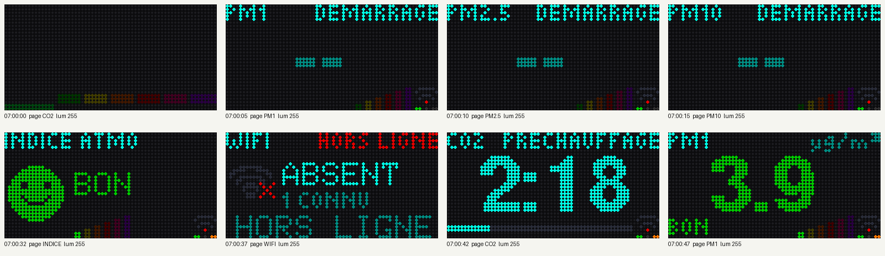
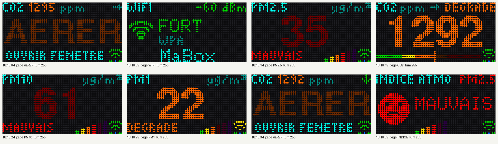

# Simulation de la carte complète

Fait tourner **tout le firmware** (`../../src/main.cpp`, sans le modifier) sur un PC : capteurs, écran LED, Wi-Fi, envois, stockage hors ligne, commandes du moniteur série. Des journées entières se simulent en quelques secondes : le temps est **virtuel** et n'avance que quand la carte attend.

C'est un complément au banc voisin (`../`), qui ne prend que le code d'envoi. Celui-ci couvre aussi l'écran, les capteurs, la machine d'état Wi-Fi, le watchdog, les redémarrages et les coupures de courant.

## Ce qui est vrai, ce qui est simulé

- **Vrai code** : `main.cpp` tel quel, plus deux bibliothèques qui ne touchent pas au matériel, dans les versions du `platformio.ini`. **ArduinoJson** produit exactement le JSON que reçoit le serveur, et **Adafruit GFX** dessine textes et polices au pixel près.
- **Simulé** (`include/`, `simulateur_carte.cpp`) :
  - **Capteurs** : le NextPM répond en Modbus, le MH-Z19C donne le CO₂ d'une salle de classe qui se remplit puis est aérée. Quelques lectures ratées au hasard.
  - **Wi-Fi et serveur** : points d'accès, coupures, Wi-Fi « fantôme », serveur AirCarto (clé, 10 s entre deux envois, 429, pannes).
  - **Mémoire et matériel** : flash LittleFS (un dossier), NVS (un fichier), watchdog, détection secteur.
  - **Ordonnancement** : `loop()` et la tâche d'envoi sont de vrais fils d'exécution, mais un seul tourne à la fois, comme sur un seul cœur.
- **Redémarrages** : `ESP.restart()`, watchdog et coupure de courant arrêtent le programme. Le script relance alors la « carte » avec sa flash et sa NVS. L'heure survit à un redémarrage logiciel, pas à une coupure de courant, comme sur l'ESP32.

## Utilisation

```sh
sh compiler.sh          # 1re fois : télécharge ArduinoJson 7.4.3 et Adafruit GFX 1.11.11, puis compile (~10 s)
python3 journee.py      # 26 h avec incidents : bilan, journal série (console.txt), planches de l'écran (ecran/*.png)
python3 blocages.py     # 2 jours sans interruption, avec une panne qui pouvait bloquer les envois sans planter la carte
```

Les résultats vont dans `sortie/`. Le scénario se règle en tête de `journee.py`, et la liste des consignes est en tête de `simulateur_carte.cpp`. Après une modification de `main.cpp`, relancer `sh compiler.sh`.

## Ce que la simulation a trouvé (novembre 2026)

Corrigé dans le firmware, puis vérifié en relançant les mêmes scénarios :

| Problème | Avant | Après |
|---|---|---|
| Un seul refus « clé invalide » (401) du serveur | plus aucun envoi jusqu'au débranchement | nouvel essai toutes les 15 min ; envois repris en 15 min, 0 mesure perdue |
| Wi-Fi « fantôme » (connecté en apparence, plus rien ne passe) | plus aucun envoi, aucune reconnexion | reconnexion après 5 échecs ; repris en 4 min, 0 mesure perdue |
| Délai `next_push_in_s` aberrant renvoyé par le serveur (2 jours) | envois suspendus 2 jours | plafonné à 5 min |
| Borne Wi-Fi éteinte la nuit | redémarrage toutes les heures (6 par nuit) | aucun : on ne redémarre que si le réseau est visible mais injoignable depuis 1 h |
| Redémarrage logiciel | 3 min de préchauffage du CO₂ perdues | aucune : le capteur est resté alimenté |
| Capteur CO₂ qui dérive (vu sur le vrai serveur : 37 ppm) | valeurs impossibles envoyées | écartées sous 300 ppm ; page CO₂ « A CALIBRER » |
| Préchauffage : « 138 » en grand | lu comme 138 ppm | « 2:18 » |
| PM1 en alerte juste après PM2.5 | 2e éclair inutile | un seul éclair |

Reste une perte **voulue** : si la carte démarre sans Wi-Fi puis que le courant est coupé avant le retour du réseau, ses mesures ne peuvent pas être datées (elle n'a jamais eu l'heure). Une horloge à pile (module RTC DS3231) l'éviterait.

### L'écran simulé

Au démarrage (le compte à rebours du préchauffage s'affiche maintenant en minutes:secondes) :



Pendant un épisode de particules, avec un CO₂ élevé :


