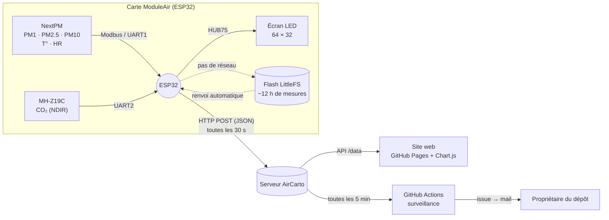

# La Bonne M’air — capteur de qualité de l’air intérieur

Station de mesure de la qualité de l’air basée sur un **ESP32 (carte ModuleAir)** : elle relève les **particules fines (PM1, PM2.5, PM10)**, le **CO₂**, la **température** et l’**humidité**, les affiche sur un **écran LED 64 × 32** et les envoie au serveur **AirCarto**. Un **site web** (hébergé sur GitHub Pages) récupère ces mesures et les présente en graphiques interactifs.

🌐 **Site en ligne :** https://astraor.github.io/0Capteur_Interne_Qualite_Air/

> Les seuils de qualité de l’air utilisés sur la carte **et** sur le site sont ceux de l’**indice ATMO** ([atmo-france.org](https://www.atmo-france.org/article/lindice-atmo), arrêté du 10 juillet 2020). Capteurs à bas coût : les valeurs sont **indicatives** et n’ont pas de valeur réglementaire.

---

## Sommaire

1. [Vue d’ensemble](#vue-densemble)
2. [Matériel et câblage](#matériel-et-câblage)
3. [Organisation du dépôt](#organisation-du-dépôt)
4. [Firmware ESP32](#firmware-esp32)
5. [Site web](#site-web)
6. [Seuils et indice ATMO](#seuils-et-indice-atmo)
7. [Alerte mail « capteur muet »](#alerte-mail--capteur-muet-)
8. [Limites connues](#limites-connues)
9. [Sources](#sources)

---

## Vue d’ensemble



**Le chemin d’une mesure :**
capteurs lus toutes les **10 s** → moyenne + pic sur **30 s** → envoi JSON au serveur AirCarto → affichage sur le site.
Sans réseau, la mesure est rangée en flash puis renvoyée plus tard avec son âge (`x_age_s`), ce qui permet au site de la remettre à sa **vraie heure**.

---

## Matériel et câblage

| Élément | Rôle | Liaison |
|---|---|---|
| ESP32 WROOM-32U (carte ModuleAir) | Microcontrôleur, Wi-Fi | — |
| **NextPM** (Tera Sensor) | Particules PM1 / PM2.5 / PM10 par diffusion laser, + T° et humidité internes | Modbus RTU sur UART1 |
| **MH-Z19C** (Winsen) | CO₂ par absorption infrarouge (NDIR) | UART2 |
| Panneau LED RGB **64 × 32** (HUB75, 1/16) | Affichage local | PxMatrix |
| Pont diviseur (optionnel) | Détection secteur / batterie | Entrée analogique |

### Brochage

| Fonction | GPIO |
|---|---|
| NextPM — RX ESP32 (fil TX capteur) | 39 |
| NextPM — TX ESP32 (fil RX capteur) | 32 |
| MH-Z19C — RX ESP32 (fil TX capteur) | 36 |
| MH-Z19C — TX ESP32 (fil RX capteur) | 27 |
| Détection secteur | 34 |
| Écran HUB75 — LAT / OE | 25 / 16 |
| Écran HUB75 — A / B / C / D / E | 17 / 33 / 4 / 12 / 15 |
| Bouton (optionnel) | `PIN_BOUTON`, désactivé par défaut (`-1`) |
| Buzzer actif (optionnel) | `PIN_BUZZER`, désactivé par défaut (`-1`) |

> Couleurs inversées sur l’écran ? Dans `setupDisplay()`, remplacer `RRBBGG` par `RRGGBB`.

---

## Organisation du dépôt

```
.
├── index.html                  # Site web (page unique : HTML + CSS + JS)
├── js/i18n.js                  # Moteur de traduction (sans dépendance)
├── lang/
│   ├── fr.js                   # Textes en français (langue d'origine)
│   ├── en.js                   # Anglais
│   └── ja.js                   # Japonais
├── img/                        # Affiche « La Bonne M'air » (900 px et 1696 px)
├── patch-lang.js               # Outil : met à jour des clés de traduction dans les 3 langues
├── Firmware/
│   ├── platformio.ini          # Configuration PlatformIO
│   ├── src/main.cpp            # Programme de la carte
│   └── simulation/             # Simulation des coupures Wi-Fi sur PC (vrai code d'envoi, voir LISEZMOI.md)
└── .github/
    ├── workflows/surveillance-capteur.yml   # Tâche planifiée toutes les 5 min
    └── scripts/surveiller-capteur.mjs       # Vérifie que le capteur envoie encore
```

---

## Firmware ESP32

### Installation (VS Code + PlatformIO)

1. Installer **VS Code** et l’extension **PlatformIO IDE**.
2. Ouvrir le dossier `Firmware/` comme projet PlatformIO.
3. Enregistrer le fichier `Firmware/PlatformIO` sous le nom **`platformio.ini`** (PlatformIO ne reconnaît que ce nom).
4. Le programme est écrit pour **ESP32 Arduino 2.x** (il refuse de compiler en 3.x). Fixer la plateforme dans `platformio.ini` :
   ```ini
   platform = espressif32@^6.0.0
   ```
5. Compiler et téléverser (`PlatformIO: Upload`), puis ouvrir le moniteur série à **115 200 bauds**.

Bibliothèques (installées automatiquement par `lib_deps`) :
`ModbusMaster 2.0.1`, `MH-Z19 ^1.5.4`, `PxMatrix 1.8.2`, `Adafruit GFX 1.11.11`, `ArduinoJson ^7.4.3`.

### Configuration par le moniteur série

Aucun identifiant n’est écrit dans le code : tout est enregistré dans la mémoire de la carte.

| Commande | Effet |
|---|---|
| `wifi ent eduroam identifiant@etablissement.fr MOT_DE_PASSE` | Ajoute un réseau WPA2-Entreprise (eduroam) |
| `wifi add MaBox MotDePasse` | Ajoute un Wi-Fi classique |
| `wifi add "iPhone de Paul" MotDePasse` | Nom avec espaces : entre guillemets |
| `wifi list` · `wifi del <n>` · `wifi scan` · `wifi connect` | Gérer les réseaux (5 au maximum) |
| `set cle <32 caractères>` | Clé du groupe AirCarto |
| `status` | État complet (réseau, capteurs, file d’attente, temps de rattrapage) |
| `verbose on` / `verbose off` | Active / coupe les logs automatiques (coupés par défaut) |
| `calib oui` | Calibrage du zéro CO₂ (après 20 min à l’air extérieur, ~400 ppm) |
| `vider_file` | Efface les mesures en attente d’envoi |
| `oublier` | Efface Wi-Fi et clé — **à faire avant de prêter la carte** |
| `aide` | Liste des commandes |

La carte se connecte seule au meilleur réseau connu visible, sans redémarrage.

### Interrupteurs de compilation (début de `main.cpp`)

| Constante | Défaut | Rôle |
|---|---|---|
| `WIFI_ACTIVE` | 1 | 0 = hors ligne (test du stockage) |
| `MODE_DEMO` | 0 | 1 = fausses valeurs qui défilent, aucun envoi |
| `MHZ_ACTIVE` / `MHZ_ABC` | 1 / 1 | Capteur CO₂ et auto-calibration |
| `NEXTPM_MOYENNE_60S` | 0 | Moyennes NextPM sur 10 s (0) ou 60 s (1) |
| `ECRAN_ETEINT_NUIT` | 0 | Écran éteint la nuit |
| `DOUBLE_BUFFER` | 1 | Dessin sans scintillement |
| `TRANSITION_FONDU` | 1 | Fondu entre les pages |
| `ANIMATIONS` | 0 | Clignements, chiffres qui glissent |
| `AFFICHER_TEMOINS` | 1 | Témoins Wi-Fi / secteur / heure / envoi en bas à droite |

### Écran LED

- **Démarrage :** logo animé « LA BONNE M’AIR ».
- **Pages (une information par écran, 5 s chacune) :** CO₂ · AÉRER (si CO₂ ≥ 1 000 ppm) · PM1 · PM2.5 · PM10 · indice ATMO · courbe du CO₂ · Wi-Fi.
- **Couleurs :** chaque valeur prend la couleur de son niveau ATMO.
- **Alerte hors norme :** dès qu’un polluant atteint son seuil d’alerte (PM : « Mauvais », CO₂ : ≥ 1 000 ppm), l’écran saute aussitôt sur sa page, clignote à la couleur du niveau, puis la valeur pulse ; la page revient une fois sur deux tant que l’alerte dure.
- **Luminosité adaptée :** jour, nuit et batterie.

### Données envoyées

Envoi JSON toutes les **30 s** (60 s sur batterie) à `http://api.aircarto.fr/iut-amu/push`.

| Champ | Contenu |
|---|---|
| `device_id`, `uptime`, `rssi`, `heap` | Identité et santé de la carte |
| `co2`, `pm1`, `pm25`, `pm10` | Moyennes sur la période |
| `x_age_s` | Secondes entre la mesure et son envoi (mesures rejouées) |
| `x_co2_max`, `x_pm25_max` | Pics sur la période |
| `x_aeration` | 1 = chute rapide du CO₂ (fenêtre ouverte ?) |
| `x_pct_co2_1000` | % du temps au-dessus de 1 000 ppm |
| `x_reset` | Cause du dernier redémarrage |
| `x_alim` | 1 = secteur, 0 = batterie |
| `x_pm_statut` | Octet d’état du NextPM |
| `x_temp_pm`, `x_hum_pm` | Température / humidité internes du NextPM |

### Robustesse

- **Mode hors ligne :** jusqu’à ~500 Ko (~12 h) de mesures stockées en flash, renvoyées automatiquement (le serveur impose 10 s entre deux envois : ~100 mesures en retard se rattrapent en ~20 min).
- **Tâches séparées :** l’envoi réseau tourne dans sa propre tâche, l’écran est rafraîchi sur le cœur 0 : l’affichage ne se fige jamais pendant un envoi.
- **Sécurités :** watchdog (60 s), redémarrage si la mémoire libre passe sous 25 Ko ou après 1 h sans Wi-Fi, heure NTP avec passage heure d’été / d’hiver.

### Horodatage des mesures (coupures Wi-Fi)

Le serveur AirCarto date chaque mesure à sa **réception** (champ `time`). Une mesure gardée en flash pendant une coupure arriverait donc à la mauvaise heure. La carte joint à chaque envoi `x_age_s`, le nombre de secondes écoulées entre la mesure et son envoi, et le site calcule : **heure réelle = `time` − `x_age_s`**.

- À la fin de chaque période de 30 s, la mesure est notée avec trois repères internes, retirés avant l'envoi : `_u` (uptime en s), `_e` (heure Unix si l'heure NTP est connue, sinon 0) et `_b` (numéro aléatoire du démarrage).
- Au moment de l'envoi, la carte calcule l'âge. Si c'est le même démarrage : uptime actuel − `_u` (marche même sans heure NTP). Sinon : heure actuelle − `_e`. Si `_e` vaut 0, la mesure ne peut pas être datée et elle est abandonnée.
- L'heure survit à un redémarrage logiciel de l'ESP32 (minuterie RTC), pas à une coupure de courant : après une coupure de courant, la carte attend l'heure NTP (15 min au plus) avant de renvoyer les mesures du démarrage précédent.
- Le site n'applique la correction qu'aux **mesures brutes** : vues 6 h et 24 h, export CSV jusqu'à 7 jours. Il écarte aussi les mesures reçues deux fois (même heure réelle à ±5 s, mêmes valeurs).
- Précision vérifiée en simulation : **±1 s** (voir [`Firmware/simulation`](Firmware/simulation/LISEZMOI.md)).

---

## Site web

Page unique, sans framework, hébergée sur **GitHub Pages** (branche `main`, racine du dépôt). Les graphiques utilisent **Chart.js 4.4.1**.

### Fonctionnalités

- **Verdict en direct** « L’air est… » avec bandeau qui prend la couleur du niveau ATMO.
- **Cartes de mesure** PM1, PM2.5, PM10, CO₂, température, humidité : dernière valeur, jauge colorée, min / max de la période.
- **Graphiques interactifs :** périodes 6 h / 24 h / 7 j ou **durée personnalisée** (5 min à 31 jours), choix du **pas de moyenne**, séries à cocher, **seuils en pointillés**, lecture au survol ou au doigt.
- **Heure réelle des mesures :** les mesures renvoyées après une coupure sont replacées à leur heure grâce à `x_age_s`.
- **Export CSV** (dans la barre collante, qui suit le défilement) : période affichée, dernière heure, 6 h, 24 h, 7 j, 30 j, **tout l'historique** ou **dates choisies dans un calendrier** (jours blancs = mesures disponibles, jours noirs = aucune mesure) ; mesures brutes (31 jours au plus par fichier) ou moyennées (5 min, 15 min, 1 h, 1 j) ; format Excel France (`;`) ou standard (`,`). Les longues périodes sont téléchargées par tranches (le serveur limite chaque requête à 7 jours en brut et 31 jours en moyennes).
- **Section « Comprendre les mesures »** : tableau des seuils et explication du calcul de l’indice.
- **3 langues** : français, anglais, japonais (choix mémorisé).
- **Mémoire du navigateur** (`localStorage`, rien n’est envoyé) : dernière période choisie (6 h, 24 h, 7 j ou durée personnalisée), pas des graphes, courbes cochées, langue. Une fois l’introduction vue (barre des mesures atteinte), les visites suivantes s’ouvrent directement sur les mesures ; on la revoit avec **00** dans le sommaire (ordinateur) ou **Introduction** (téléphone).
- **Barre des réglages** collée en haut ; sur téléphone, elle se range quand on descend et revient dès qu’on remonte.
- **Confort :** écran d’entrée plein écran, bouton flottant « Aller aux mesures » pour sauter l’introduction, animations réductibles, mise à jour automatique toutes les 5 min.

### Réglages (`index.html`, section « 1) RÉGLAGES »)

| Constante | Rôle |
|---|---|
| `CLE` | Clé du groupe AirCarto (32 caractères) |
| `DEVICE_ID` | Adresse MAC d’une carte précise, ou `""` pour toutes |
| `RAFRAICHISSEMENT_MS` | Intervalle de mise à jour (5 min) |

### Traductions

Les textes sont dans `lang/*.js` ; le HTML les référence par `data-i18n="clé"`.
Pour ajouter une langue : copier `lang/fr.js` en `lang/xx.js`, traduire les valeurs (jamais les clés), l’inclure dans `index.html` avant `js/i18n.js` et l’ajouter dans `LANGUES` (`js/i18n.js`).
Pour vérifier qu’aucune clé ne manque : `I18N.verifier()` dans la console du navigateur.

### Tester en local

```bash
python -m http.server 8000
# puis ouvrir http://localhost:8000
```

---

## Seuils et indice ATMO

Les mêmes seuils sont codés dans la carte (`SEUILS_PM25`, `SEUILS_PM10`, `SEUILS_CO2`) et dans le site (`SEUILS`).

### Particules (µg/m³) — indice ATMO

| Niveau | PM2.5 (et PM1) | PM10 |
|---|---|---|
| 🟦 Bon | 0 – 10 | 0 – 20 |
| 🟩 Moyen | 11 – 20 | 21 – 40 |
| 🟨 Dégradé | 21 – 25 | 41 – 50 |
| 🟥 Mauvais | 26 – 50 | 51 – 100 |
| 🟪 Très mauvais | 51 – 75 | 101 – 150 |
| 🟣 Extrêmement mauvais | > 75 | > 150 |

### CO₂ (ppm) — indicateur d’aération

| Niveau | CO₂ |
|---|---|
| Bon | < 800 |
| Moyen | 800 – 999 |
| Dégradé (page « AÉRER ») | 1 000 – 1 499 |
| Mauvais (buzzer si câblé) | ≥ 1 500 |

### Calcul du verdict

On applique la règle officielle de l’indice ATMO : chaque polluant reçoit un **sous-indice** sur sa propre échelle, et le verdict est le **plus dégradé** des sous-indices — **ni moyenne, ni pondération**.

- Entrent dans le verdict : **PM2.5, PM10 et PM1** (l’indice ATMO ne fixant pas de seuil pour les PM1, on leur applique ceux des PM2.5).
- Le **CO₂** n’est pas un polluant de l’indice : il est affiché à part comme indicateur d’aération.
- L’indice ATMO complet inclut aussi l’ozone, le NO₂ et le SO₂ (non mesurés ici) et porte sur des moyennes **journalières** : notre verdict est donc un **indice partiel et indicatif**.

---

## Alerte mail « capteur muet »

Le workflow `.github/workflows/surveillance-capteur.yml` interroge le serveur AirCarto **toutes les 5 minutes**.
Si aucune mesure n’est arrivée depuis `SEUIL_MIN` minutes (10 par défaut), il ouvre une issue **« Capteur muet »** assignée au propriétaire du dépôt → GitHub envoie un **mail**. Quand les mesures reviennent, l’issue se ferme toute seule (second mail).

Réglages dans **Settings → Secrets and variables → Actions** :

| Nom | Type | Rôle |
|---|---|---|
| `AIRCARTO_CLE` | secret | Clé du groupe (sinon lue dans `index.html`) |
| `SEUIL_MIN` | variable | Minutes sans mesure avant l’alerte (défaut 10) |
| `DEVICE_ID` | variable | Surveiller une seule carte (défaut : toutes) |

Test manuel : onglet **Actions → Surveillance du capteur → Run workflow**.
GitHub peut retarder les tâches planifiées de quelques minutes, et les met en pause après 60 jours sans commit sur un dépôt public.

---

## Limites connues

- Capteurs à bas coût : mesures indicatives, sans valeur réglementaire.
- Le MH-Z19C a besoin d’environ **3 minutes de chauffe** ; l’auto-calibration suppose que la pièce est aérée régulièrement.
- Température et humidité proviennent des capteurs internes du NextPM : elles reflètent l’air dans le boîtier, souvent un peu plus chaud que la pièce.
- Le serveur n’accepte qu’**un envoi toutes les 10 s** : c’est lui qui limite la vitesse de rattrapage après une coupure.
- Vue **7 jours** et durées personnalisées de plus de 24 h : le site reçoit des moyennes de 5 min calculées par le serveur **par heure de réception**. Pendant le rattrapage après une coupure, une moyenne mélange des mesures rejouées et des mesures fraîches : la période de la coupure y apparaît lissée et décalée (en simulation, un pic de 10 min apparaît ~45 min trop tard et atténué). Les vues 6 h / 24 h et l’export CSV (jusqu’à 7 jours) restent exacts.
- Carte démarrée **sans Wi-Fi** (donc sans heure) puis coupure de courant avant le retour du Wi-Fi : les mesures de ce démarrage ne peuvent pas être datées et sont abandonnées.

---

## Sources

- Atmo France — [L’indice ATMO](https://www.atmo-france.org/article/lindice-atmo) (seuils et couleurs des particules)
- Arrêté du 10 juillet 2020 relatif à l’indice de la qualité de l’air ambiant
- HCSP — recommandations sur l’aération et la ventilation (repères CO₂)
- Tera Sensor — fiche technique NextPM · Winsen — fiche technique MH-Z19C
- AirCarto — serveur de collecte des mesures (`api.aircarto.fr`)
